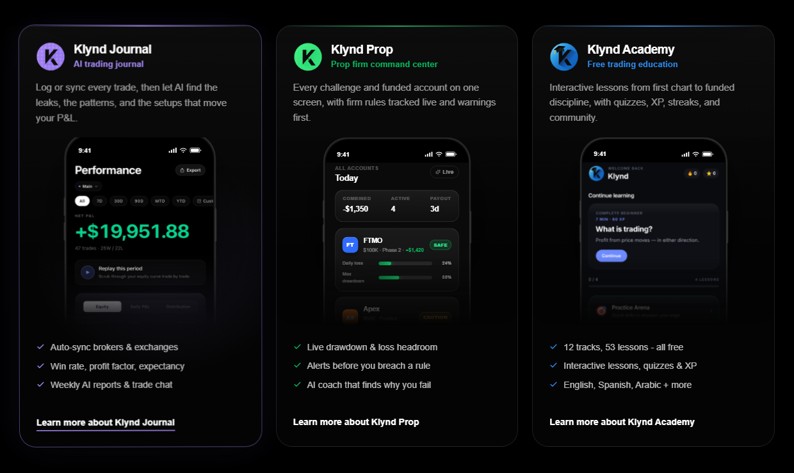
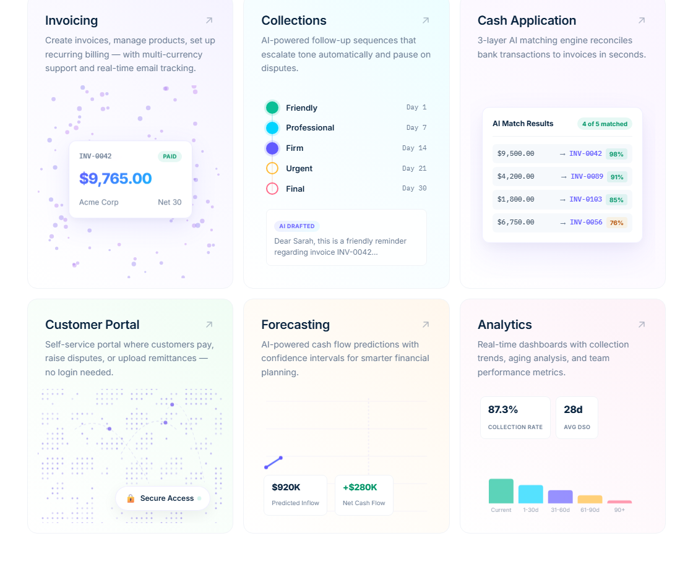
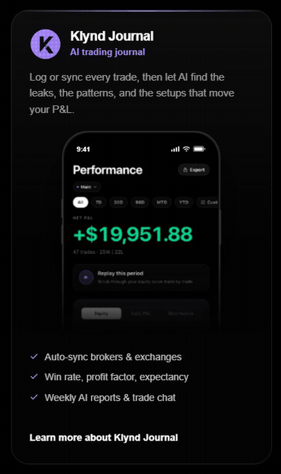
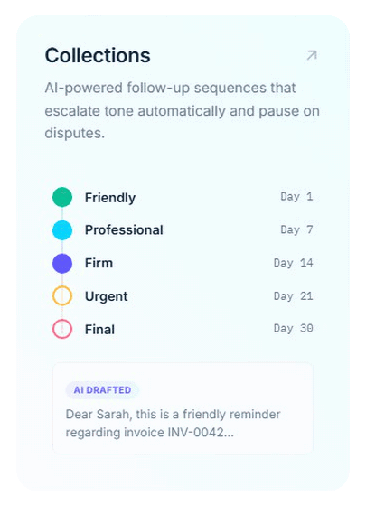
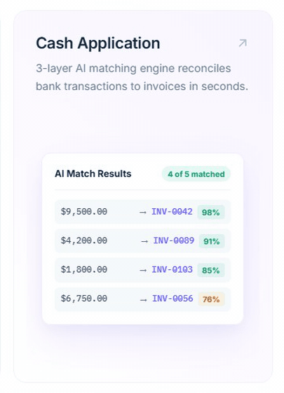
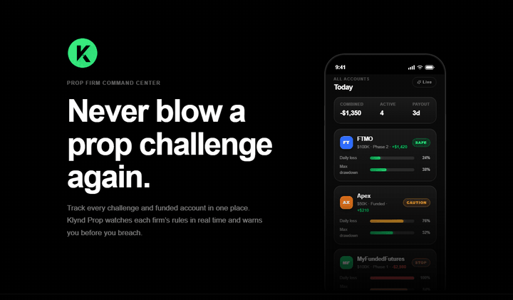
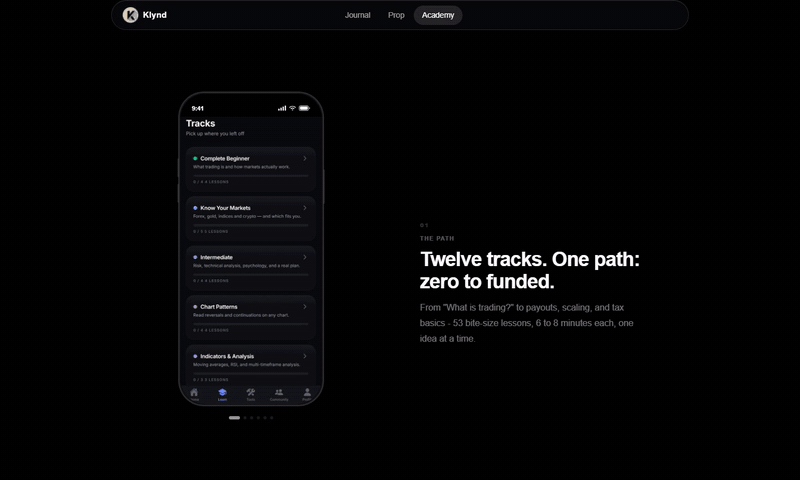
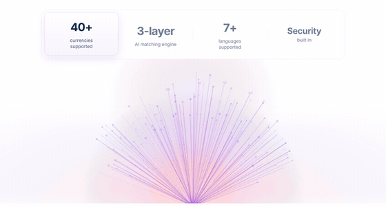
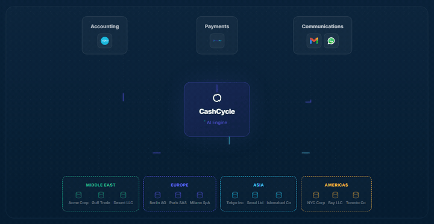

# Frontend UX Motion Skills

A collection of 28 agent skills for frontend design, UX, and web animation. Each skill includes implementation guidance and a standalone HTML and JavaScript example that runs without dependencies.

## Live website examples

These captures show the interactions on the live sites. The [live interaction guide](examples/live-captures/README.md) maps each effect to its example scripts.

| [Klynd](https://klynd.trade/) | [CashCycle](https://cashcycle.ai/) |
| --- | --- |
|  |  |

Klynd card animations

| Journal | Prop | Academy |
| --- | --- | --- |
|  |  |  |

CashCycle card animations

| Invoicing | Collections | Cash Application |
| --- | --- | --- |
|  |  |  |

| Customer Portal | Forecasting | Analytics |
| --- | --- | --- |
|  |  |  |

### Klynd app pages

| [Journal](https://klynd.trade/journal) | [Prop](https://klynd.trade/prop) | [Academy](https://klynd.trade/academy) |
| --- | --- | --- |
|  |  |  |
| [Moving integrations carousel](examples/live-captures/klynd-journal-marquee.gif) | [Landing page screenshot](examples/live-captures/klynd-prop-landing.png) | [Moving screenshot gallery](examples/live-captures/klynd-academy-gallery.gif) |

### More from CashCycle

#### Built for finance teams that move fast

The four controls switch the canvas between **40+ currencies supported**, **3-layer AI matching**, **7+ languages supported**, and **Security**. The pointer also changes the artwork within each mode.

[Full-resolution screenshot](examples/live-captures/cashcycle-stats.png) · [Reusable visualization mode example](skills/animate-visualization-modes/examples/example.js)

| Stacked workflow cards | Integration diagram |
| --- | --- |
|  |  |
| [Screenshot](examples/live-captures/cashcycle-workflow.png) | [Screenshot](examples/live-captures/cashcycle-integrations.png) |

## Use a skill

Clone the repository and open a skill's `examples/example.html` in your browser. Its `examples/example.js` contains the interaction code. Point your coding agent to the skill's `SKILL.md` or copy the complete skill folder into your agent's skills directory.

For example, ask your agent to use `animate-card-tilt` to add a small pointer tilt while preserving existing links and touch behavior.

| Skill | Run locally |
| --- | --- |
| [Pointer tilt](skills/animate-card-tilt/SKILL.md) | [Example](skills/animate-card-tilt/examples/example.html) |
| [Pointer spotlight](skills/animate-pointer-spotlights/SKILL.md) | [Example](skills/animate-pointer-spotlights/examples/example.html) |
| [Product preview lift](skills/animate-product-previews/SKILL.md) | [Example](skills/animate-product-previews/examples/example.html) |
| [Reactive canvas particles](skills/animate-canvas-particles/SKILL.md) | [Example](skills/animate-canvas-particles/examples/example.html) |
| [Reactive paths and nodes](skills/animate-reactive-paths/SKILL.md) | [Example](skills/animate-reactive-paths/examples/example.html) |
| [Sticky scroll stories](skills/animate-scroll-stories/SKILL.md) | [Example](skills/animate-scroll-stories/examples/example.html) |
| [Viewport reveals](skills/animate-viewport-reveals/SKILL.md) | [Example](skills/animate-viewport-reveals/examples/example.html) |
| [Count-up metrics](skills/animate-count-up-metrics/SKILL.md) | [Example](skills/animate-count-up-metrics/examples/example.html) |
| [Seamless marquees](skills/animate-seamless-marquees/SKILL.md) | [Example](skills/animate-seamless-marquees/examples/example.html) |
| [SVG line drawing](skills/animate-svg-path-drawing/SKILL.md) | [Example](skills/animate-svg-path-drawing/examples/example.html) |
| [Dashboard choreography](skills/animate-dashboard-sequences/SKILL.md) | [Example](skills/animate-dashboard-sequences/examples/example.html) |
| [Ambient backgrounds](skills/animate-ambient-backgrounds/SKILL.md) | [Example](skills/animate-ambient-backgrounds/examples/example.html) |
| [Hero media timelines](skills/animate-hero-media/SKILL.md) | [Example](skills/animate-hero-media/examples/example.html) |
| [Disclosure and menu motion](skills/animate-disclosures-and-menus/SKILL.md) | [Example](skills/animate-disclosures-and-menus/examples/example.html) |
| [Visualization mode changes](skills/animate-visualization-modes/SKILL.md) | [Example](skills/animate-visualization-modes/examples/example.html) |
| [Feedback microinteractions](skills/animate-feedback-states/SKILL.md) | [Example](skills/animate-feedback-states/examples/example.html) |
| [Reactive bar illustrations](skills/animate-reactive-bars/SKILL.md) | [Example](skills/animate-reactive-bars/examples/example.html) |
| [Icon flips](skills/animate-icon-flips/SKILL.md) | [Example](skills/animate-icon-flips/examples/example.html) |
| [Swipe galleries](skills/animate-swipe-galleries/SKILL.md) | [Example](skills/animate-swipe-galleries/examples/example.html) |
| [Product website structure](skills/design-product-websites/SKILL.md) | [Example](skills/design-product-websites/examples/example.html) |
| [Light and dark theme tokens](skills/build-theme-systems/SKILL.md) | [Example](skills/build-theme-systems/examples/example.html) |
| [Basic frontend audit script](skills/audit-frontend-experiences/SKILL.md) | [Example](skills/audit-frontend-experiences/examples/example.html) |
| [Motion preference and lifecycle](skills/animate-frontend-interfaces/SKILL.md) | [Example](skills/animate-frontend-interfaces/examples/example.html) |
| [Workflow app landing pages](skills/design-workflow-app-landing/SKILL.md) | [Example](skills/design-workflow-app-landing/examples/example.html) |
| [Learning app landing pages](skills/design-learning-app-landing/SKILL.md) | [Example](skills/design-learning-app-landing/examples/example.html) |
| [Monitoring app landing pages](skills/design-monitoring-app-landing/SKILL.md) | [Example](skills/design-monitoring-app-landing/examples/example.html) |
| [Stacked workflow cards](skills/animate-stacked-workflow-cards/SKILL.md) | [Example](skills/animate-stacked-workflow-cards/examples/example.html) |
| [Animated integration connectors](skills/animate-integration-connectors/SKILL.md) | [Example](skills/animate-integration-connectors/examples/example.html) |

## License

The skills and example code are source-available under the [Frontend UX Motion Skills License](LICENSE). Use them for free in personal and commercial projects, including paid client work. Keep the attribution and license notice when redistributing the materials, identify changes, and credit the original project. Selling the materials as a skill pack or another paid resource is prohibited, including modified versions. The live website captures are shown for illustration and are excluded from the license.
