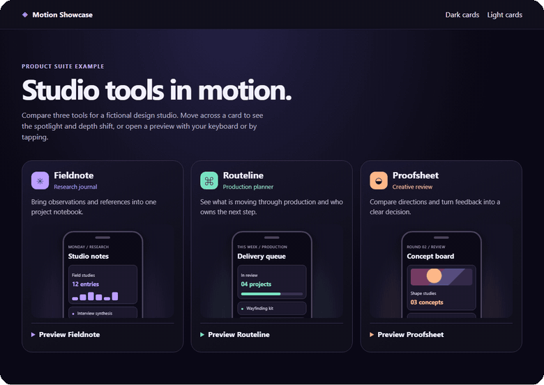
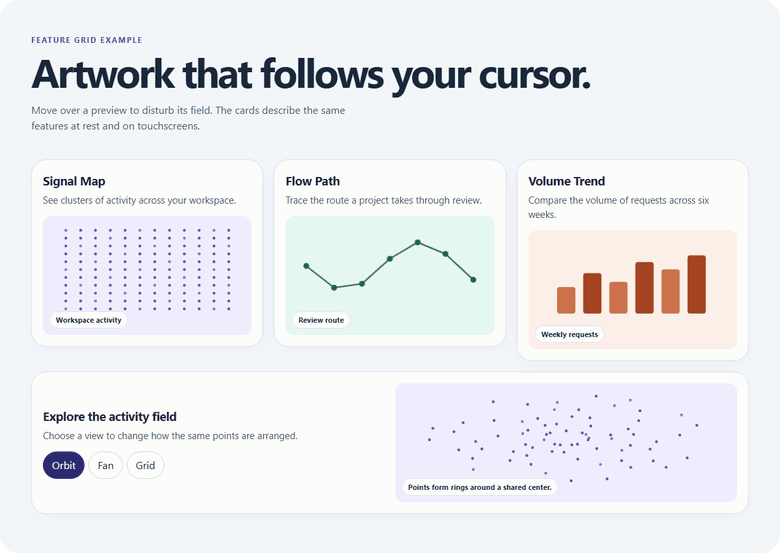
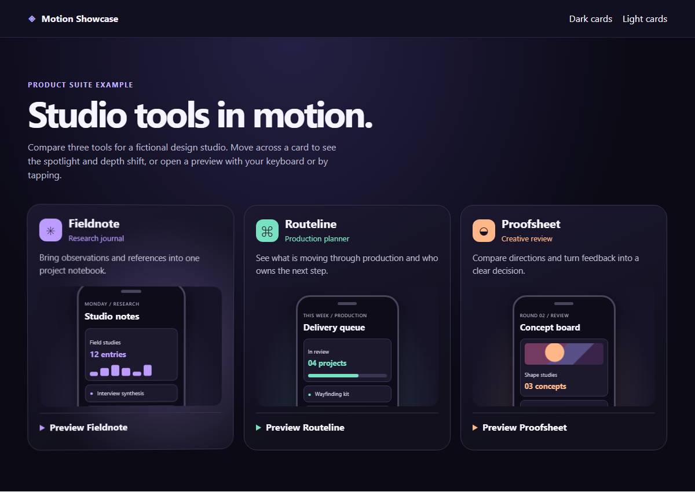
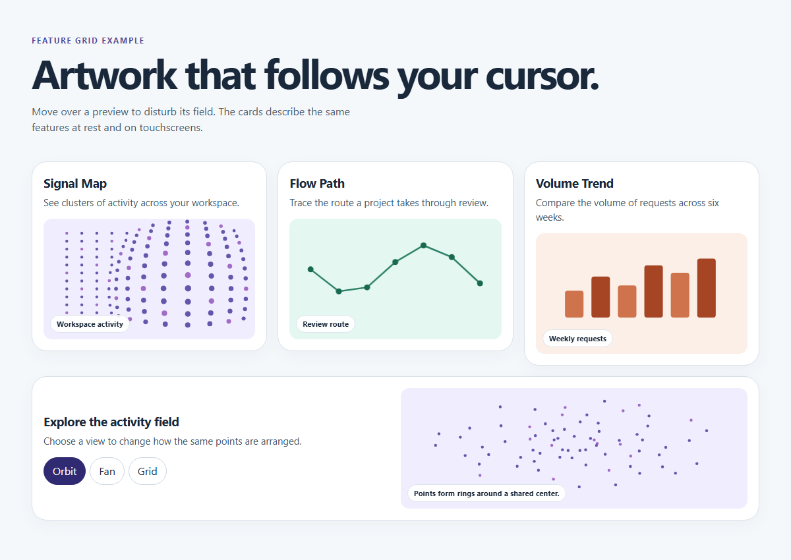

# Frontend Design Agent Skills

A collection of 23 skills for designing, building, and testing product websites. Each skill includes a browser-ready example and readable JavaScript. The examples use fictional product content and run without dependencies.

## Motion showcase

[Browse the demo source](examples/motion-showcase/) or clone this repo and open `examples/motion-showcase/index.html`. The dark grid combines a pointer spotlight, product preview lift, and keyboard-accessible disclosures. The light grid contains reactive particles, a route, a bar illustration, and a field with selectable layouts.

| Dark product cards | Light feature cards |
| --- | --- |
|  |  |
|  |  |

## Use a skill

Copy a complete skill directory into your coding agent's skills folder, or point the agent to its `SKILL.md` in your checkout. Open its `examples/example.html` in a browser and inspect `examples/example.js` to see what drives the interaction. For example, ask the agent to use `animate-card-tilt` to add a small pointer tilt without changing existing links or touch behavior.

| Skill | Run locally |
| --- | --- |
| [Pointer tilt](skills/animate-card-tilt/SKILL.md) | [Example](skills/animate-card-tilt/examples/example.html) |
| [Pointer spotlight](skills/animate-pointer-spotlights/SKILL.md) | [Example](skills/animate-pointer-spotlights/examples/example.html) |
| [Product preview lift](skills/animate-product-previews/SKILL.md) | [Example](skills/animate-product-previews/examples/example.html) |
| [Reactive canvas particles](skills/animate-canvas-particles/SKILL.md) | [Example](skills/animate-canvas-particles/examples/example.html) |
| [Reactive paths and nodes](skills/animate-reactive-paths/SKILL.md) | [Example](skills/animate-reactive-paths/examples/example.html) |
| [Sticky scroll stories](skills/animate-scroll-stories/SKILL.md) | [Example](skills/animate-scroll-stories/examples/example.html) |
| [Viewport reveals](skills/animate-viewport-reveals/SKILL.md) | [Example](skills/animate-viewport-reveals/examples/example.html) |
| [Count-up metrics](skills/animate-count-up-metrics/SKILL.md) | [Example](skills/animate-count-up-metrics/examples/example.html) |
| [Seamless marquees](skills/animate-seamless-marquees/SKILL.md) | [Example](skills/animate-seamless-marquees/examples/example.html) |
| [SVG line drawing](skills/animate-svg-path-drawing/SKILL.md) | [Example](skills/animate-svg-path-drawing/examples/example.html) |
| [Dashboard choreography](skills/animate-dashboard-sequences/SKILL.md) | [Example](skills/animate-dashboard-sequences/examples/example.html) |
| [Ambient backgrounds](skills/animate-ambient-backgrounds/SKILL.md) | [Example](skills/animate-ambient-backgrounds/examples/example.html) |
| [Hero media timelines](skills/animate-hero-media/SKILL.md) | [Example](skills/animate-hero-media/examples/example.html) |
| [Disclosure and menu motion](skills/animate-disclosures-and-menus/SKILL.md) | [Example](skills/animate-disclosures-and-menus/examples/example.html) |
| [Visualization mode changes](skills/animate-visualization-modes/SKILL.md) | [Example](skills/animate-visualization-modes/examples/example.html) |
| [Feedback microinteractions](skills/animate-feedback-states/SKILL.md) | [Example](skills/animate-feedback-states/examples/example.html) |
| [Reactive bar illustrations](skills/animate-reactive-bars/SKILL.md) | [Example](skills/animate-reactive-bars/examples/example.html) |
| [Icon flips](skills/animate-icon-flips/SKILL.md) | [Example](skills/animate-icon-flips/examples/example.html) |
| [Swipe galleries](skills/animate-swipe-galleries/SKILL.md) | [Example](skills/animate-swipe-galleries/examples/example.html) |
| [Product website structure](skills/design-product-websites/SKILL.md) | [Example](skills/design-product-websites/examples/example.html) |
| [Light and dark theme tokens](skills/build-theme-systems/SKILL.md) | [Example](skills/build-theme-systems/examples/example.html) |
| [Basic frontend audit script](skills/audit-frontend-experiences/SKILL.md) | [Example](skills/audit-frontend-experiences/examples/example.html) |
| [Motion preference and lifecycle](skills/animate-frontend-interfaces/SKILL.md) | [Example](skills/animate-frontend-interfaces/examples/example.html) |

## License

Free for personal and commercial project use. You can sell websites and client work you create with the skills. Redistribution of the materials requires attribution and the included terms, and paid redistribution of the materials and their adaptations is restricted. See [LICENSE](LICENSE).
