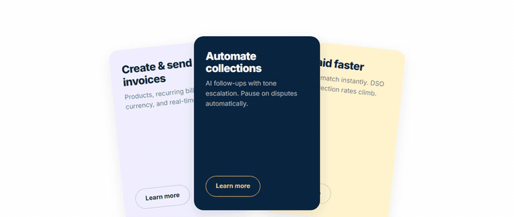
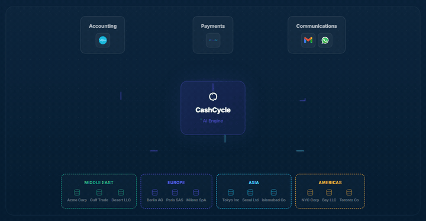
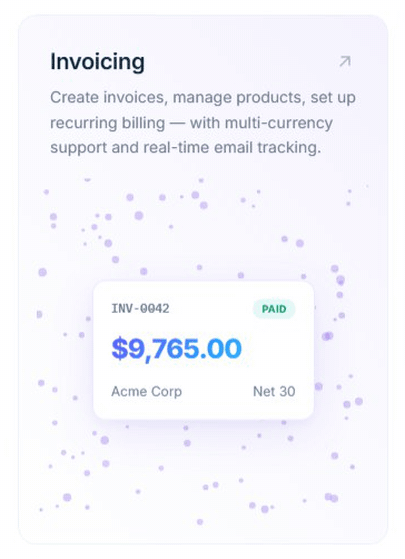
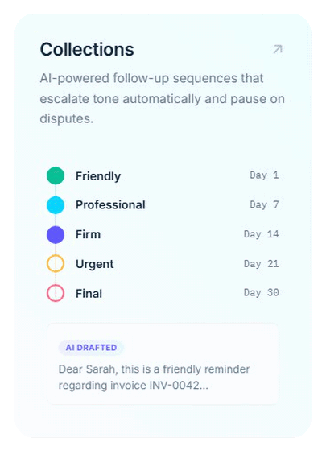
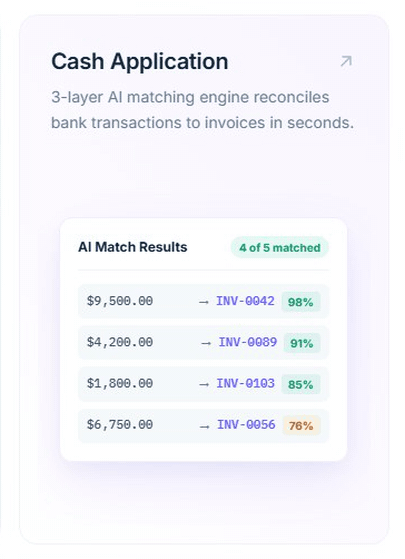
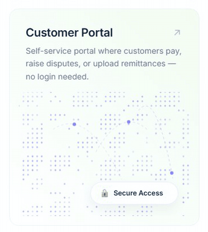
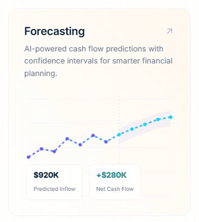
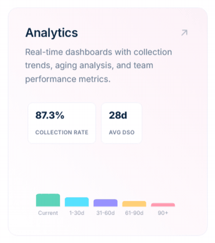

# CashCycle motion gallery

[Back to Frontend UX Motion Skills](../../README.md) · [Try the live site](https://cashcycle.ai/)

## Stacked workflow cards

[Skill instructions](../../skills/animate-stacked-workflow-cards/SKILL.md) · [Example JavaScript](../../skills/animate-stacked-workflow-cards/examples/example.js)

## Integration diagram

[Skill instructions](../../skills/animate-integration-connectors/SKILL.md) · [Example JavaScript](../../skills/animate-integration-connectors/examples/example.js)

## Feature card motion

| Invoicing | Collections | Cash Application |
| --- | --- | --- |
|  |  |  |
| [Canvas particles](../../skills/animate-canvas-particles/SKILL.md) | [Feedback states](../../skills/animate-feedback-states/SKILL.md) | [Dashboard sequences](../../skills/animate-dashboard-sequences/SKILL.md) |

| Customer Portal | Forecasting | Analytics |
| --- | --- | --- |
|  |  |  |
| [Canvas particles](../../skills/animate-canvas-particles/SKILL.md) | [Reactive paths](../../skills/animate-reactive-paths/SKILL.md) | [Reactive bars](../../skills/animate-reactive-bars/SKILL.md) |
