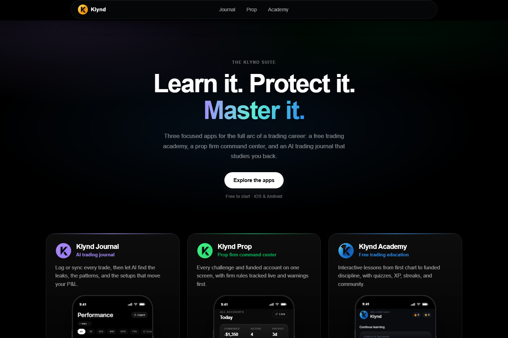
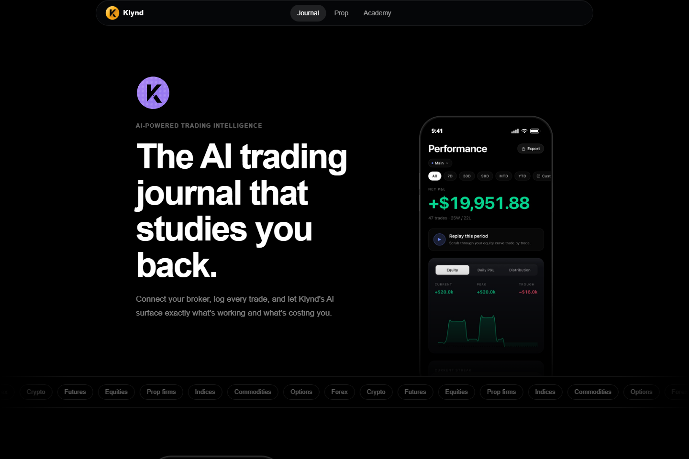
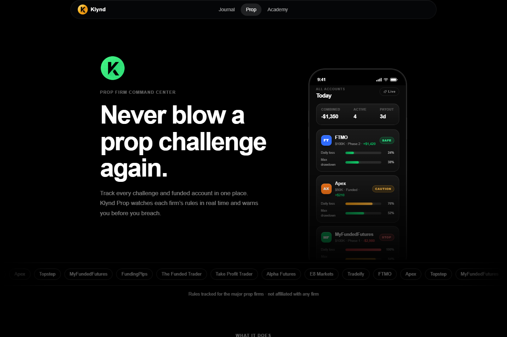
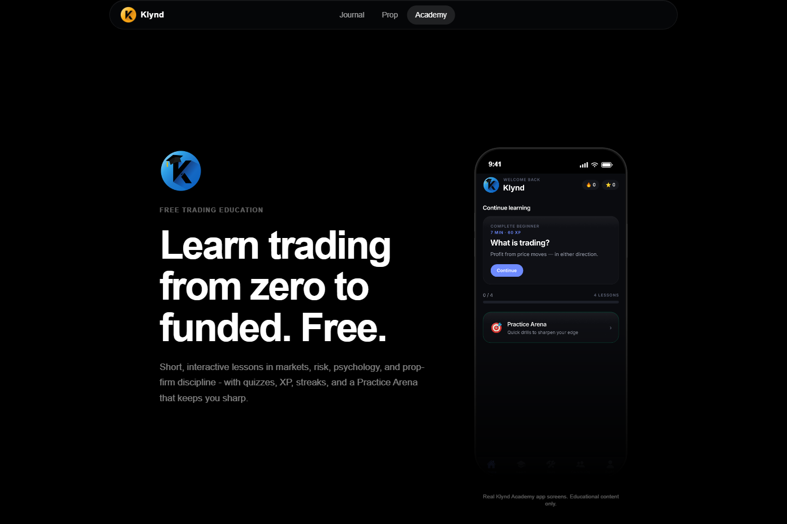
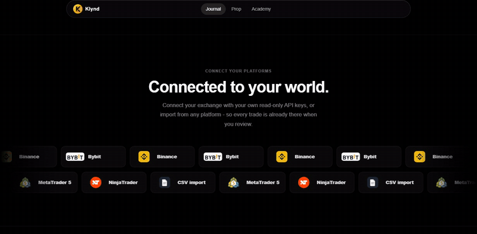
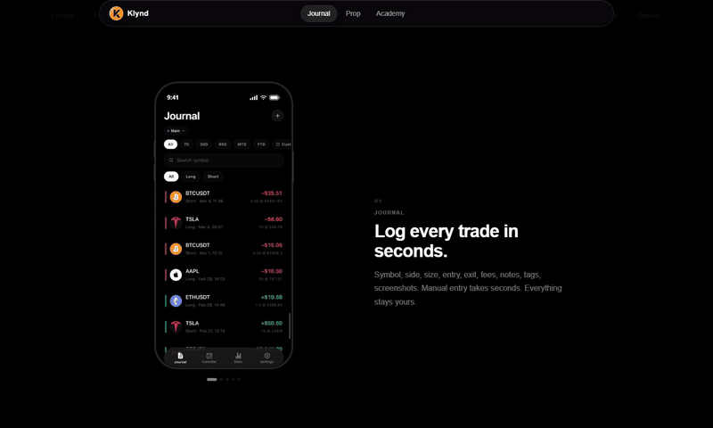
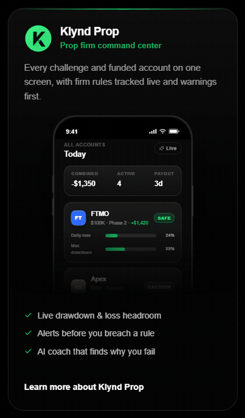
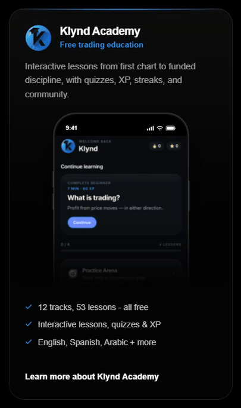
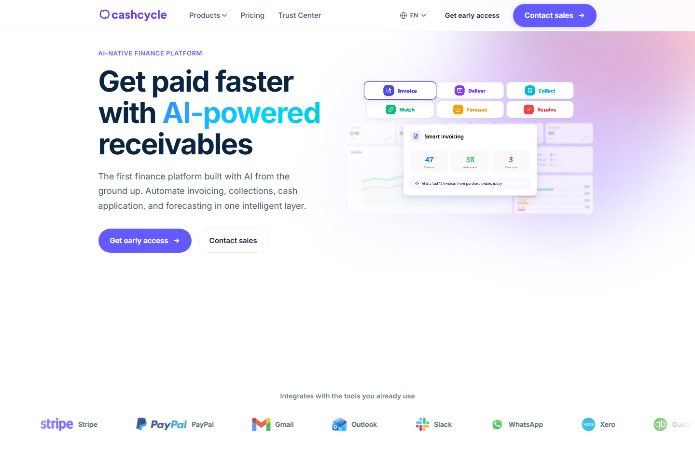

# Live website gallery

[Back to the project README](../../README.md) · [Klynd](https://klynd.trade/) · [CashCycle](https://cashcycle.ai/)

### Klynd landing pages and carousels

| [Journal](https://klynd.trade/journal) | [Prop](https://klynd.trade/prop) | [Academy](https://klynd.trade/academy) |
| --- | --- | --- |
|  |  |  |
| [Market ticker in motion](klynd-journal-landing.gif) | [Prop-firm ticker in motion](klynd-prop-landing.gif) | [Pinned lesson walkthrough](klynd-academy-story.gif) |

#### Integrations carousel and pinned walkthroughs

**Journal integrations carousel**

[Integrations screenshot](klynd-journal-integrations.png)

| Journal walkthrough | Academy walkthrough |
| --- | --- |
|  |  |
| [Screenshot](klynd-journal-story.png) | [Screenshot](klynd-academy-story.png) |

#### Product card motion

[Full product grid](klynd-product-cards.png)

| Journal | Prop | Academy |
| --- | --- | --- |
|  |  |  |

### CashCycle landing page and feature cards

[Animated homepage hero and logo rail](cashcycle-home.gif) · [Full feature grid](cashcycle-feature-cards.png)

#### Feature card motion

| Invoicing | Collections | Cash Application |
| --- | --- | --- |
|  |  |  |

| Customer Portal | Forecasting | Analytics |
| --- | --- | --- |
|  |  |  |

#### Built for finance teams that move fast

Four controls switch the Canvas visualization between **40+ currencies**, **3-layer AI matching**, **7+ languages**, and **Security**. The pointer interacts with the artwork within each mode.

[Stats screenshot](cashcycle-stats.png) · [Visualization mode script](../../skills/animate-visualization-modes/examples/example.js)

| Stacked workflow cards | Integration diagram |
| --- | --- |
|  |  |
| [Screenshot](cashcycle-workflow.png) | [Screenshot](cashcycle-integrations.png) |

## Match a demo to its skill

Use this guide to connect an observed interaction with a reusable example. The standalone scripts use original, fictional content. They demonstrate the mechanics in isolation so you can integrate them into an existing layout.

| Live interaction | Reusable examples |
| --- | --- |
| Klynd product cards tilt, move an accent highlight, and lift the phone previews | [Card tilt](../../skills/animate-card-tilt/examples/example.js), [pointer spotlights](../../skills/animate-pointer-spotlights/examples/example.js), [product preview lift](../../skills/animate-product-previews/examples/example.html) |
| Klynd Journal, Prop, and Academy organize their landing pages around distinct product goals | [Workflow app](../../skills/design-workflow-app-landing/SKILL.md), [monitoring app](../../skills/design-monitoring-app-landing/SKILL.md), [learning app](../../skills/design-learning-app-landing/SKILL.md) |
| Klynd Journal and Academy pin a phone while the walkthrough changes screens | [Pinned scroll stories](../../skills/animate-scroll-stories/examples/example.js) |
| Klynd Journal runs two integration rails in opposite directions, and Journal and Prop include moving tickers beneath their heroes | [Seamless marquees](../../skills/animate-seamless-marquees/examples/example.js) |
| CashCycle places a transparent dashboard animation beside the hero copy and a moving logo rail below | [Hero media timelines](../../skills/animate-hero-media/examples/example.js), [seamless marquees](../../skills/animate-seamless-marquees/examples/example.js) |
| CashCycle Invoicing and Customer Portal move particles and nodes inside the artwork | [Reactive particles](../../skills/animate-canvas-particles/examples/example.js), [reactive paths](../../skills/animate-reactive-paths/examples/example.js) |
| CashCycle Collections and Cash Application layer status and changes inside mock UI | [Dashboard sequences](../../skills/animate-dashboard-sequences/examples/example.js), [feedback states](../../skills/animate-feedback-states/examples/example.js) |
| CashCycle Forecasting and Analytics react within chart previews | [Reactive paths](../../skills/animate-reactive-paths/examples/example.js), [reactive bars](../../skills/animate-reactive-bars/examples/example.js) |
| CashCycle stats change both the highlighted control and the canvas arrangement | [Visualization modes](../../skills/animate-visualization-modes/examples/example.js), [count-up metrics](../../skills/animate-count-up-metrics/examples/example.js) |
| CashCycle workflow cards emphasize one step in a layered stack | [Stacked workflow cards](../../skills/animate-stacked-workflow-cards/examples/example.js), [card stack implementation notes](#stacked-workflow-cards) |
| CashCycle integrations send signals along connectors and change icon faces | [Animated integration connectors](../../skills/animate-integration-connectors/examples/example.js), [icon flips](../../skills/animate-icon-flips/examples/example.js), [integration implementation notes](#integration-connectors) |

## Stacked workflow cards

- Keep keyboard focus and explicit selection on a stable wrapper. Apply rotation, offset, opacity, and stacking order to visual layers in CSS.
- Make keyboard focus promote its card. Keep previous and next actions reachable when layers overlap. Use explicit buttons if touch users need to switch cards.
- Collapse the composition to in-flow cards when space or reduced-motion preferences call for simpler presentation.

## Integration connectors

- Draw the complete connector graph in its resting state. Use a second short dash on each active path to indicate a signal.
- Offset routes using different delays. Keep the pulse pattern independent of node text and provide a pause control for sustained motion.
- Use a neutral static diagram under reduced motion. Keep equivalent node names and relationships available in HTML.
